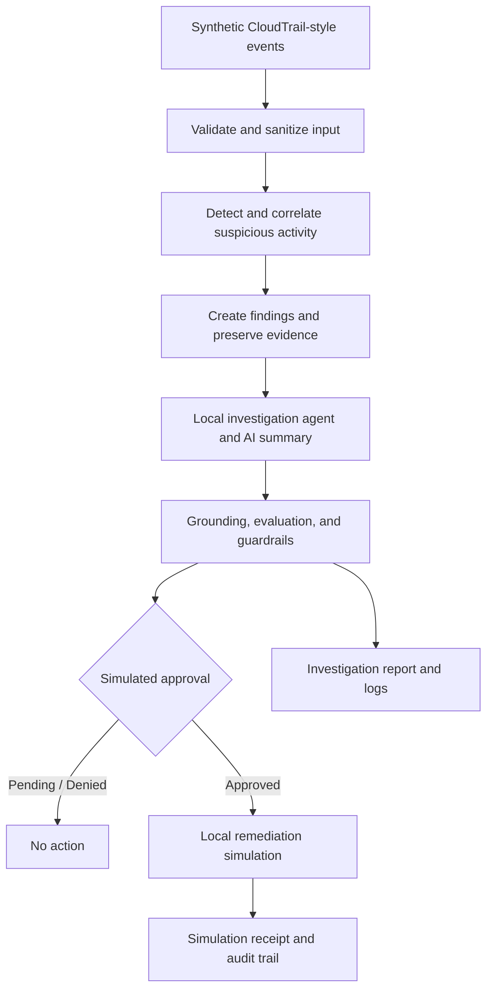

# AI Security Incident Investigator

**Python security automation | AWS-style security events | DevSecOps | AI safety controls**

A **local-first, end-to-end security investigation prototype** that turns synthetic AWS CloudTrail-style login events into structured findings, evidence-backed investigations, and approval-gated *simulated* remediation. Built to demonstrate practical cloud security automation, defensive software engineering, and secure AI-assisted workflows.

[](https://github.com/AlexiusThomas/ai-security-incident-investigator/actions/workflows/python-tests.yml)
[](https://github.com/AlexiusThomas/ai-security-incident-investigator/actions/workflows/security-checks.yml)

> **Scope:** All event data is synthetic. AI summaries, approval identities, evidence storage, and remediation are simulated locally. The Terraform AWS configuration is a **blueprint that has not been deployed**. This is an engineering portfolio project, **not a production security tool**.

## What it demonstrates

- **Detection and correlation:** Normalize events, classify findings, and identify suspicious login sequences, including failures followed by success.
- **Evidence integrity:** Record local evidence and verify its SHA-256 checksum before using it in an investigation.
- **AI-assisted analysis with guardrails:** Generate deterministic Bedrock-style investigation summaries, check evidence grounding, and evaluate agent responses without external model calls.
- **Safety controls:** Sanitize untrusted event fields, restrict agent tools, reject invalid approval decisions, and test malicious or forged input.
- **Human approval boundary:** Keep actions pending or blocked unless approved; even approved actions change only *simulated local state*.
- **Engineering reliability:** Add structured reporting, bounded retries, failure handling, audit records, unit tests, and CI security checks.

## Investigation flow



## Technical stack

| Area | Technologies and patterns |
| --- | --- |
| Language and testing | Python 3.13, JSON, `unittest`, Windows PowerShell |
| Detection and investigation | CloudTrail-style events, rule-based detection, event correlation, evidence verification |
| AI safety prototype | Local Bedrock-style responses, agent allowlists, output evaluation, adversarial input tests |
| AWS infrastructure design | Terraform blueprint for Lambda, EventBridge, IAM, CloudWatch Logs, and an encrypted S3 evidence bucket |
| CI and security checks | GitHub Actions, Bandit, pip-audit, Terraform formatting and validation |

## Run locally

**Requirements:** Python 3.13 and a terminal (PowerShell is used in the example). No AWS account, credentials, or Bedrock access is required.

```powershell
git clone https://github.com/AlexiusThomas/ai-security-incident-investigator.git
cd ai-security-incident-investigator
py -m pip install -r requirements.txt

# Run the end-to-end local acceptance scenarios
py capstone_final.py

# Run all unit tests
py -m unittest discover -s . -p "test_*.py" -v
```

The capstone tests **PENDING**, **APPROVED**, and **DENIED** decisions. Its negative checks cover untrusted instruction-like metadata, invalid approval overrides, and path traversal. A successful run writes `day40_output/capstone_summary.json`. All remediation checks confirm **no real AWS action occurred**.

## Code map

| Area | Files |
| --- | --- |
| Detection and correlation | [`detection_engine.py`](detection_engine.py), [`cloudtrail_ingest.py`](cloudtrail_ingest.py), [`login_sequence_detector.py`](login_sequence_detector.py) |
| Investigation and evidence | [`investigate.py`](investigate.py), [`evidence_store.py`](evidence_store.py), [`report_incident.py`](report_incident.py) |
| AI-assisted investigation | [`local_security_agent.py`](local_security_agent.py), [`bedrock_local.py`](bedrock_local.py), [`ai_guardrails.py`](ai_guardrails.py) |
| Controls and response | [`adversarial_gate.py`](adversarial_gate.py), [`approval_workflow.py`](approval_workflow.py), [`remediation_simulator.py`](remediation_simulator.py) |
| End-to-end acceptance | [`capstone_final.py`](capstone_final.py), [`test_capstone_final.py`](test_capstone_final.py) |
| Infrastructure blueprint | [`infra/day35/main.tf`](infra/day35/main.tf) |
| CI checks | [Python tests](.github/workflows/python-tests.yml), [security scanning and Terraform validation](.github/workflows/security-checks.yml) |

## Verification and security boundaries

GitHub Actions runs the Python test suite and separate checks for Python source scanning, dependency auditing, Terraform formatting, and Terraform validation. See the [Actions tab](https://github.com/AlexiusThomas/ai-security-incident-investigator/actions) for live results.

The solution is designed to **fail safely in a simulated environment**. Its controls do not establish production authentication, tamper-proof audit storage, operational incident-response approvals, or real AWS containment. A production implementation would require independent authorization, secured cloud identity and evidence storage, deployment testing, monitoring, and a reviewed threat model.

## Portfolio documentation

- [Project overview and engineering highlights](docs/PORTFOLIO.md)
- [Architecture, components, boundaries, and limitations](docs/ARCHITECTURE.md)

## Next steps

- Add an authorized sandbox deployment with a security review and least-privilege runtime roles.
- Replace simulated components selectively with real AWS integrations and protected evidence storage.
- Add deployment tests, observability, and a short end-to-end demonstration video.

**Focus:** Cloud Security Engineering · Security Automation · DevSecOps · Secure AI Workflows
